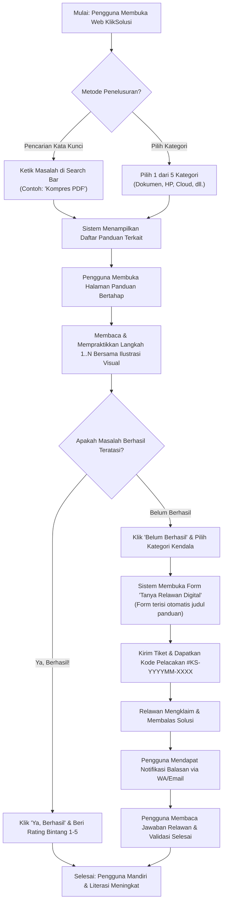
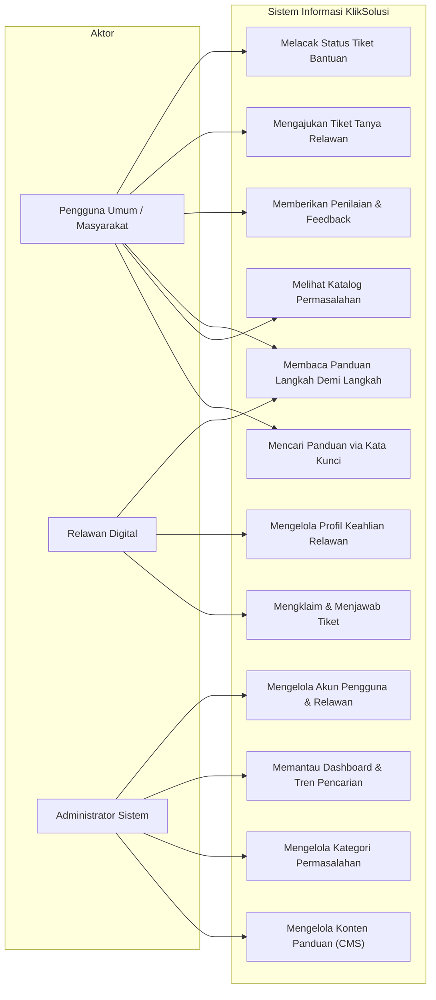
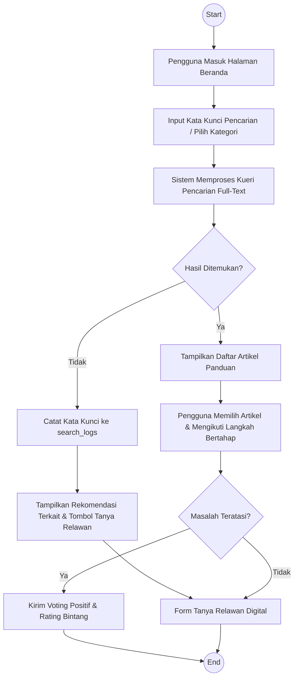
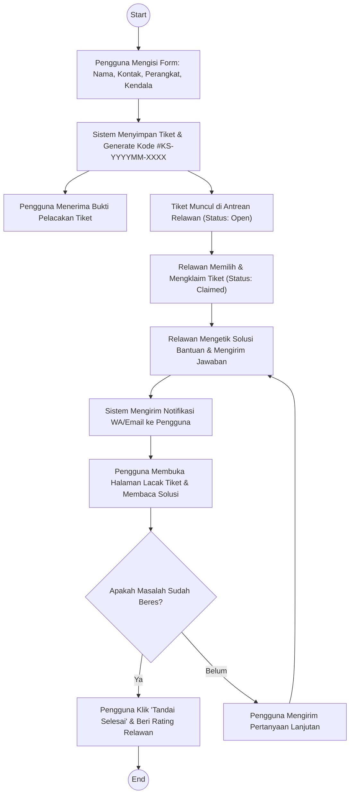
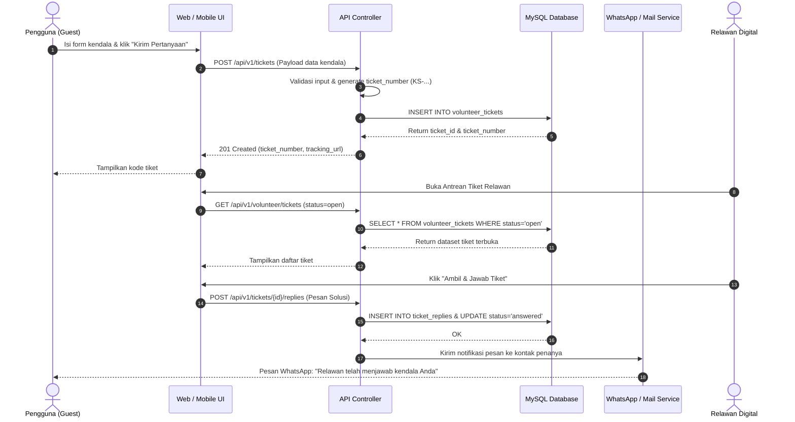

# PERANCANGAN SISTEM
## KLIK SOLUSI
### Sistem Informasi Pusat Panduan dan Penyelesaian Masalah Teknologi Digital Sehari-hari

---

## DAFTAR ISI
1. [Arsitektur Sistem Terpadu](#1-arsitektur-sistem-terpadu)
2. [Alur Penggunaan Platform](#2-alur-penggunaan-platform)
3. [Diagram Alir Pengguna (User Flowchart)](#3-diagram-alir-pengguna-user-flowchart)
4. [Diagram Use Case (Use Case Diagram)](#4-diagram-use-case-use-case-diagram)
5. [Activity Diagram](#5-activity-diagram)
   - [5.1 Aktivitas 1: Pencarian Panduan dan Evaluasi Solusi](#51-aktivitas-1-pencarian-panduan-dan-evaluasi-solusi)
   - [5.2 Aktivitas 2: Pengajuan dan Penyelesaian Tiket Relawan](#52-aktivitas-2-pengajuan-dan-penyelesaian-tiket-relawan)
6. [Sequence Diagram](#6-sequence-diagram)
7. [Prinsip Desain Antarmuka (UI/UX) & Wireframe](#7-prinsip-desain-antarmuka-uiux--wireframe)

---

## 1. ARSITEKTUR SISTEM TERPADU

KlikSolusi dirancang menggunakan arsitektur **Berbasis Web Responsif** (*Responsive Web-Based Architecture*) yang mengintegrasikan antarmuka web modern dengan backend **Laravel 11 / 12** dan basis data relasional **MySQL**. Sistem dapat diakses langsung oleh masyarakat melalui peramban (*web browser*) pada berbagai perangkat, baik komputer/laptop (desktop 1440×900) maupun smartphone (mobile browser):

```
+-----------------------------------------------------------------------------------+
|                                 CLIENT INTERFACE                                  |
|   +------------------------------------+  +-----------------------------------+   |
|   |    Desktop Web Browser (1440x900)  |  |    Mobile Web Browser (360px+)    |   |
|   |    (Chrome, Edge, Firefox, Safari) |  |    (Chrome Mobile, Safari iOS)    |   |
|   +------------------------------------+  +-----------------------------------+   |
+------------------------------------------+----------------------------------------+
                                           | HTTPS / HTML5 & JSON API
+------------------------------------------v----------------------------------------+
|                                BACKEND APPLICATION                                |
|   +---------------------------------------------------------------------------+   |
|   |                             LARAVEL 11 / 12                               |   |
|   |  - Web & API Routing Layer (Blade Engine + REST API Endpoints)            |   |
|   |  - Controller Layer (Catalog, Solution, Volunteer Ticket, Admin)          |   |
|   |  - Business Service & Validation Logic (Form Requests & Rules)            |   |
|   |  - Eloquent ORM Data Mapping Layer                                        |   |
|   +---------------------------------------------------------------------------+   |
+------------------------------------------+----------------------------------------+
                                           | SQL / Storage Driver
+------------------------------------------v----------------------------------------+
|                              DATA & STORAGE SERVICES                              |
|   +---------------------+   +---------------------+   +-----------------------+   |
|   |   MySQL 8.0 /       |   |    Local / Cloud    |   |     WhatsApp API /    |   |
|   |   InnoDB Database   |   |   Storage (Images)  |   |     SMTP Mailer       |   |
|   +---------------------+   +---------------------+   +-----------------------+   |
+-----------------------------------------------------------------------------------+
```

---

## 2. ALUR PENGGUNAAN PLATFORM

Secara umum, alur penggunaan platform KlikSolusi mengikuti 6 tahapan utama:
1. **Membuka Platform**: Pengguna mengakses situs web KlikSolusi melalui peramban (*browser*) ponsel maupun komputer.
2. **Memilih Kategori atau Mencari**: Pengguna memilih kategori permasalahan yang sesuai (Dokumen, Perangkat, Komunikasi, Penyimpanan, Layanan Publik) atau mengetikkan kata kunci kendala pada kolom pencarian.
3. **Melihat Rekomendasi Solusi**: Sistem menampilkan daftar artikel panduan penyelesaian yang relevan dengan kebutuhan pengguna.
4. **Membaca & Mempraktikkan Panduan**: Pengguna membaca panduan bertahap dan mengikuti setiap langkah instruksi yang dilengkapi gambar visual pendukung.
5. **Memberikan Penilaian**: Pengguna memberikan umpan balik penilaian keberhasilan (`Ya, Berhasil` atau `Belum Berhasil`).
6. **Bantuan Relawan Digital**: Apabila permasalahan belum terselesaikan secara mandiri, pengguna dapat langsung mengajukan pertanyaan kendala kepada relawan digital.

---

## 3. DIAGRAM ALIR PENGGUNA (USER FLOWCHART)



---

## 4. DIAGRAM USE CASE (USE CASE DIAGRAM)

Terdapat 3 aktor yang berinteraksi dengan sistem KlikSolusi:



---

## 5. ACTIVITY DIAGRAM

### 5.1 Aktivitas 1: Pencarian Panduan dan Evaluasi Solusi



### 5.2 Aktivitas 2: Pengajuan dan Penyelesaian Tiket Relawan



---

## 6. SEQUENCE DIAGRAM

Interaksi antar komponen saat pengguna mengajukan pertanyaan ke Relawan Digital:



---

## 7. PRINSIP DESAIN ANTARMUKA (UI/UX) & WIREFRAME

Antarmuka web KlikSolusi menerapkan standar **Anti-Slop UI & Netral**:

1. **Kanvas Bersih & Terang**:
   * Warna latar belakang: Netral `#F8F9FA` (canvas) dan `#FFFFFF` (card surfaces).
   * Border kontainer: Halus `#E2E8F0` dengan radius sudut `12px - 14px`.
2. **Zero-Emoji & Ikon Vektor Lucide**:
   * Tidak menggunakan emoji teks (`✨`, `🔥`, `🚀`).
   * Seluruh ikon menggunakan vektor resmi Lucide (`box`, `shield`, `folder`, `zap`, `arrowRight`, `check`, `lock`, `mail`, `barChart`, `bookOpen`, `user`, `logout`, `download`, `image`, `trash2`).
3. **Tipografi Ramah Pemula & Lansia**:
   * Font utama: `Plus Jakarta Sans` dengan hierarki kontras tinggi:
     * Judul Layar: Bold 24–32px (`#1E1E2D`).
     * Teks Utama: Medium 14–15px (`#1E1E2D` / `#475569`).
     * Label Muted: Regular 12px (`#8F92A1`).
4. **Navigasi Bersih Tanpa Tombol Login Pengunjung**:
   * Navbar publik hanya memuat 4 menu utama (*Beranda, Katalog Panduan, Tanya Relawan, Tentang KlikSolusi*).
   * Tautan login staf pengelola diletakkan secara diskret di bagian footer (*Portal Admin & Relawan ->*).

---

### Berkas Desain Wireframe FigCraft

Seluruh 12 frame rancangan antarmuka (UI/UX) disusun secara rapi, modular, dan terukur dalam berkas desain resmi:
📁 **[docs/landing_page_kliksolusi.figcraft](file:///c:/kliksolusi/docs/landing_page_kliksolusi.figcraft)**

Daftar 12 Frame Wireframe (Ukuran Standar 1440px, Jarak Horizontal 120px):

#### Baris 1 — Alur Navigasi & Panduan Publik (Koordinat Y = 0 px)
1. **`01 - Beranda`** (X: 0, 1440×1300 px):
   - Hero ramah pemula: *"Ada Kendala Teknologi Hari Ini? Cari Solusinya di Sini"*.
   - Kolom pencarian instan besar dengan tombol aksi dan 6 chip kendala cepat.
   - 5 Kartu kategori utama (*Dokumen, Perangkat, Penyimpanan, Komunikasi, Layanan Publik*).
   - 6 Kartu panduan paling sering dicari lengkap dengan indikator waktu baca dan tingkat keberhasilan solusi.
   - Banner call-to-action konsultasi ke Relawan Digital.
2. **`02 - Hasil Pencarian`** (X: 1560, 1440×1100 px):
   - Sidebar filter kategori pencarian di kolom kiri.
   - Daftar kartu hasil pencarian yang relevan di kolom kanan.
   - Callout ramah *"Tidak menemukan solusi yang sesuai dengan masalah Anda?"* menuju pengajuan tiket relawan.
3. **`03 - Katalog Panduan`** (X: 3120, 1440×1300 px):
   - Filter bar chip kategori digital dan dropdown pengurutan (*Terbaru, Terpopuler*).
   - Grid panduan 3 kolom responsif dengan badge kategori.
   - Navigasi pagination di bagian bawah.
4. **`04 - Detail Panduan Visual`** (X: 4680, 1440×1500 px):
   - Tata letak 1 kolom fokus membaca yang nyaman (*readable width*).
   - Breadcrumb, badge kategori, dan indikator persentase terbantu.
   - Kartu instruksi bertahap langkah-demi-langkah dengan nomor besar dan bahasa sederhana.
   - Kotak pratinjau ilustrasi/tangkapan layar di setiap langkah.
   - Widget feedback interaktif: *"Apakah panduan ini berhasil menyelesaikan masalah Anda? (Ya / Belum)"*.
5. **`05 - Konfirmasi Penilaian Panduan`** (X: 6240, 1440×1100 px):
   - Alert konfirmasi sukses setelah pengunjung memberikan penilaian.
   - Rekomendasi panduan terkait dan jalan pintas kembali ke katalog.

#### Baris 2 — Alur Konsultasi Relawan & Tentang (Koordinat Y = 1650 px)
6. **`06 - Tanya Relawan (Form)`** (X: 0, 1440×1200 px):
   - Segmented tab switcher (*Ajukan Pertanyaan Baru* [Aktif] dan *Cek Status Tiket*).
   - Form konsultasi tanpa registrasi akun: Nama Panggilan, Kategori Masalah, Judul Kendala, Detail Permasalahan (textarea), Dropzone Upload Screenshot Error, dan Kontak WhatsApp/Email untuk notifikasi.
   - Panel samping kanan: Tips menulis pertanyaan agar cepat dijawab & widget status 18 relawan aktif online.
7. **`07 - Tiket Berhasil Dibuat`** (X: 1560, 1440×1100 px):
   - Ikon centang hijau besar dan pesan konfirmasi pengiriman tiket.
   - Highlight box Kode Tiket Unik (`KS-2026-849`) beserta tombol salin instan.
   - Kartu pengingat penting penyimpanan kode tiket dan tombol lacak status tiket.
8. **`08 - Cek Status & Balasan Relawan`** (X: 3120, 1440×1250 px):
   - Kolom pencarian kode tiket dengan pre-fill `KS-2026-849` dan tombol cek status.
   - Status badge hijau *"Sudah Dijawab oleh Relawan"*.
   - Quote pertanyaan asli pengguna beserta lampiran.
   - Kotak balasan relawan digital (*Rian Pratama*): 4 langkah solusi terstruktur, screenshot panduan, tombol konfirmasi tuntas, dan tombol tanya lanjutan.
9. **`09 - Tentang KlikSolusi`** (X: 4680, 1440×1300 px):
   - Bagian 1: Latar belakang & misi literasi digital mandiri untuk semua kalangan masyarakat.
   - Bagian 2: 6 Kartu alur penggunaan visual platform (*Buka Web → Pilih/Cari → Lihat Panduan → Ikuti Visual → Beri Penilaian → Tanya Relawan*).
   - Bagian 3: 4 Kartu profil target pengguna utama (*Pemula Digital, Pelajar, Pekerja, Lansia*).
   - Bagian 4: 5 Accordion FAQ interaktif seputar keamanan dan legalitas layanan gratis.

#### Baris 3 — Portal Pengelola (Admin & Relawan) (Koordinat Y = 3300 px)
10. **`10 - Login Admin & Relawan`** (X: 0, 1440×900 px):
    - Halaman login khusus staf pengelola (diakses via link footer).
    - Kartu login di tengah canvas dengan enkripsi SSL 256-bit, input email, password dengan ikon intip, dan tombol pintas kembali ke beranda publik.
11. **`11 - Dashboard Admin & Analitik`** (X: 1560, 1440×1150 px):
    - Sidebar navigasi admin terpadu.
    - 4 Kartu KPI metrik utama (*Total Pengunjung 12.480, Total Panduan 86, Rasio Solusi Berhasil 94,5%, Tiket Menunggu 4*).
    - Grafik batang permasalahan paling sering dicari minggu ini.
    - Feed langsung umpan balik kepuasan pengguna.
    - Tabel analitik performa panduan paling sering diakses beserta rating dan status publikasi.
12. **`12 - Panel Jawab Tiket Relawan`** (X: 3120, 1440×1150 px):
    - Ruang kerja relawan digital dengan sidebar profil relawan.
    - Kolom kiri: Daftar antrean tiket masuk dengan filter status (*Menunggu, Diproses, Selesai*).
    - Kolom kanan: Detail kendala pengguna (`#KS-2026-849` - Pak Joko Subagyo), lampiran screenshot pengguna, editor textarea langkah solusi terstruktur, box lampiran ilustrasi jawaban, dan tombol kirim balasan ke pengguna via WhatsApp/Web.
