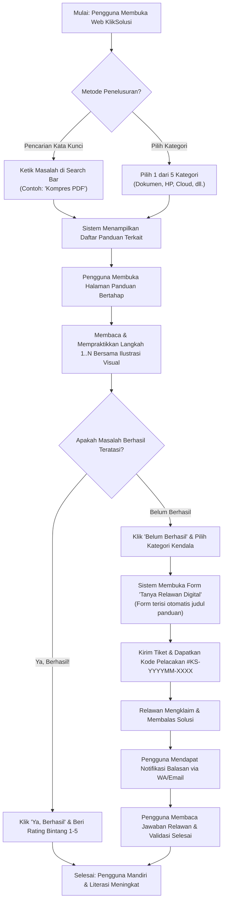
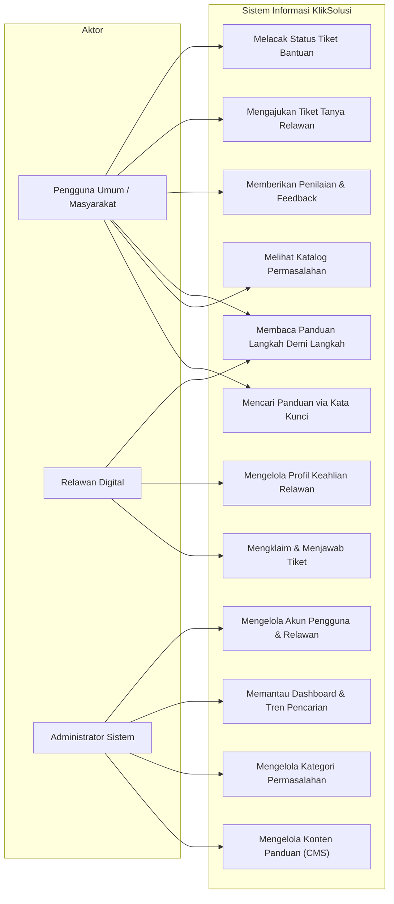
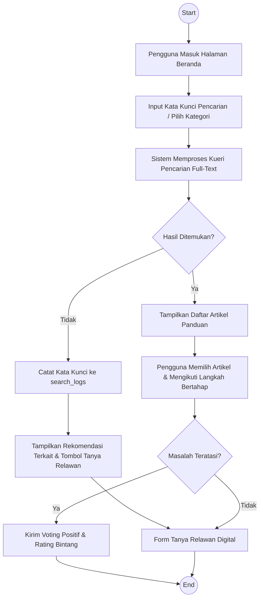
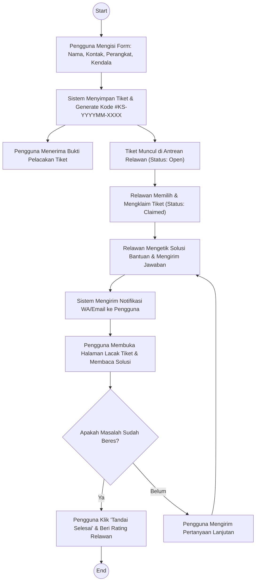
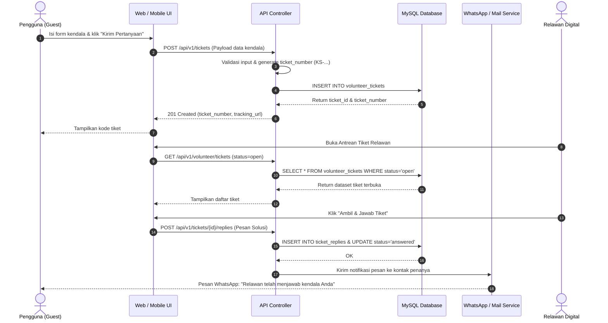

# PERANCANGAN SISTEM
## KLIK SOLUSI
### Sistem Informasi Pusat Panduan dan Penyelesaian Masalah Teknologi Digital Sehari-hari

---

## DAFTAR ISI
1. [Arsitektur Sistem Terpadu](#1-arsitektur-sistem-terpadu)
2. [Alur Penggunaan Platform](#2-alur-penggunaan-platform)
3. [Diagram Alir Pengguna (User Flowchart)](#3-diagram-alir-pengguna-user-flowchart)
4. [Diagram Use Case (Use Case Diagram)](#4-diagram-use-case-use-case-diagram)
5. [Activity Diagram](#5-activity-diagram)
   - [5.1 Aktivitas 1: Pencarian Panduan dan Evaluasi Solusi](#51-aktivitas-1-pencarian-panduan-dan-evaluasi-solusi)
   - [5.2 Aktivitas 2: Pengajuan dan Penyelesaian Tiket Relawan](#52-aktivitas-2-pengajuan-dan-penyelesaian-tiket-relawan)
6. [Sequence Diagram](#6-sequence-diagram)
7. [Prinsip Desain Antarmuka (UI/UX) & Wireframe](#7-prinsip-desain-antarmuka-uiux--wireframe)

---

## 1. ARSITEKTUR SISTEM TERPADU

KlikSolusi dirancang menggunakan arsitektur **Berbasis Web Responsif** (*Responsive Web-Based Architecture*) yang mengintegrasikan antarmuka web modern dengan backend **Laravel 11 / 12** dan basis data relasional **MySQL**. Sistem dapat diakses langsung oleh masyarakat melalui peramban (*web browser*) pada berbagai perangkat, baik komputer/laptop (desktop 1440×900) maupun smartphone (mobile browser):

```
+-----------------------------------------------------------------------------------+
|                                 CLIENT INTERFACE                                  |
|   +------------------------------------+  +-----------------------------------+   |
|   |    Desktop Web Browser (1440x900)  |  |    Mobile Web Browser (360px+)    |   |
|   |    (Chrome, Edge, Firefox, Safari) |  |    (Chrome Mobile, Safari iOS)    |   |
|   +------------------------------------+  +-----------------------------------+   |
+------------------------------------------+----------------------------------------+
                                           | HTTPS / HTML5 & JSON API
+------------------------------------------v----------------------------------------+
|                                BACKEND APPLICATION                                |
|   +---------------------------------------------------------------------------+   |
|   |                             LARAVEL 11 / 12                               |   |
|   |  - Web & API Routing Layer (Blade Engine + REST API Endpoints)            |   |
|   |  - Controller Layer (Catalog, Solution, Volunteer Ticket, Admin)          |   |
|   |  - Business Service & Validation Logic (Form Requests & Rules)            |   |
|   |  - Eloquent ORM Data Mapping Layer                                        |   |
|   +---------------------------------------------------------------------------+   |
+------------------------------------------+----------------------------------------+
                                           | SQL / Storage Driver
+------------------------------------------v----------------------------------------+
|                              DATA & STORAGE SERVICES                              |
|   +---------------------+   +---------------------+   +-----------------------+   |
|   |   MySQL 8.0 /       |   |    Local / Cloud    |   |     WhatsApp API /    |   |
|   |   InnoDB Database   |   |   Storage (Images)  |   |     SMTP Mailer       |   |
|   +---------------------+   +---------------------+   +-----------------------+   |
+-----------------------------------------------------------------------------------+
```

---

## 2. ALUR PENGGUNAAN PLATFORM

Secara umum, alur penggunaan platform KlikSolusi mengikuti 6 tahapan utama:
1. **Membuka Platform**: Pengguna mengakses situs web KlikSolusi melalui peramban (*browser*) ponsel maupun komputer.
2. **Memilih Kategori atau Mencari**: Pengguna memilih kategori permasalahan yang sesuai (Dokumen, Perangkat, Komunikasi, Penyimpanan, Layanan Publik) atau mengetikkan kata kunci kendala pada kolom pencarian.
3. **Melihat Rekomendasi Solusi**: Sistem menampilkan daftar artikel panduan penyelesaian yang relevan dengan kebutuhan pengguna.
4. **Membaca & Mempraktikkan Panduan**: Pengguna membaca panduan bertahap dan mengikuti setiap langkah instruksi yang dilengkapi gambar visual pendukung.
5. **Memberikan Penilaian**: Pengguna memberikan umpan balik penilaian keberhasilan (`Ya, Berhasil` atau `Belum Berhasil`).
6. **Bantuan Relawan Digital**: Apabila permasalahan belum terselesaikan secara mandiri, pengguna dapat langsung mengajukan pertanyaan kendala kepada relawan digital.

---

## 3. DIAGRAM ALIR PENGGUNA (USER FLOWCHART)



---

## 4. DIAGRAM USE CASE (USE CASE DIAGRAM)

Terdapat 3 aktor yang berinteraksi dengan sistem KlikSolusi:



---

## 5. ACTIVITY DIAGRAM

### 5.1 Aktivitas 1: Pencarian Panduan dan Evaluasi Solusi



### 5.2 Aktivitas 2: Pengajuan dan Penyelesaian Tiket Relawan



---

## 6. SEQUENCE DIAGRAM

Interaksi antar komponen saat pengguna mengajukan pertanyaan ke Relawan Digital:



---

## 7. PRINSIP DESAIN ANTARMUKA (UI/UX) & WIREFRAME

Antarmuka web KlikSolusi menerapkan standar **Anti-Slop UI & Netral**:

1. **Kanvas Bersih & Terang**:
   * Warna latar belakang: Netral `#F8F9FA` (canvas) dan `#FFFFFF` (card surfaces).
   * Border kontainer: Halus `#E2E8F0` dengan radius sudut `12px - 14px`.
2. **Zero-Emoji & Ikon Vektor Lucide**:
   * Tidak menggunakan emoji teks (`✨`, `🔥`, `🚀`).
   * Seluruh ikon menggunakan vektor resmi Lucide (`box`, `shield`, `folder`, `zap`, `arrowRight`, `check`).
3. **Tipografi Ramah Pemula & Lansia**:
   * Font utama: `Plus Jakarta Sans` dengan hierarki kontras tinggi:
     * Judul Layar: Bold 28–32px (`#1E1E2D`).
     * Teks Utama: Medium 14–15px (`#1E1E2D` / `#475569`).
     * Label Muted: Regular 12px (`#8F92A1`).
4. **Layout Wireframe Desktop (1440 × 900)**:
   * **Header Bar**: Tinggi 72px, logo kontras, navigasi kategori, dan tombol bantuan.
   * **Hero Section**: Bilah pencarian instan dengan status indikator aktif dan kartu rangkuman statistik.
   * **Pilar Layanan**: Grid 3 kartu terstruktur dengan tag pill informatif.
   * **Footer**: Tautan kebijakan privasi dan pemantauan status operasional server.
