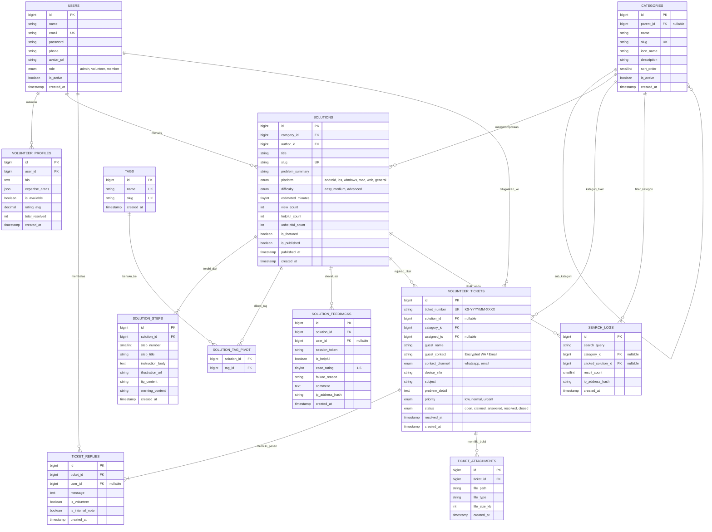

# STRUKTUR DATABASE & TABEL
## KLIK SOLUSI
### Sistem Informasi Pusat Panduan dan Penyelesaian Masalah Teknologi Digital Sehari-hari

---

## DAFTAR ISI
1. [Prinsip Desain Basis Data](#1-prinsip-desain-basis-data)
2. [Entity-Relationship Diagram (ERD)](#2-entity-relationship-diagram-erd)
3. [Kamus Data & Struktur 11 Tabel](#3-kamus-data--struktur-11-tabel)
   - [3.1 Tabel `users`](#31-tabel-users)
   - [3.2 Tabel `volunteer_profiles`](#32-tabel-volunteer_profiles)
   - [3.3 Tabel `categories`](#33-tabel-categories)
   - [3.4 Tabel `solutions`](#34-tabel-solutions)
   - [3.5 Tabel `solution_steps`](#35-tabel-solution_steps)
   - [3.6 Tabel `tags` & `solution_tag`](#36-tabel-tags--solution_tag)
   - [3.7 Tabel `volunteer_tickets`](#37-tabel-volunteer_tickets)
   - [3.8 Tabel `ticket_replies`](#38-tabel-ticket_replies)
   - [3.9 Tabel `ticket_attachments`](#39-tabel-ticket_attachments)
   - [3.10 Tabel `solution_feedbacks`](#310-tabel-solution_feedbacks)
   - [3.11 Tabel `search_logs`](#311-tabel-search_logs)
4. [Strategi Indexing & Full-Text Search](#4-strategi-indexing--full-text-search)
5. [Skrip DDL SQL Produksi Lengkap](#5-skrip-ddl-sql-produksi-lengkap)

---

## 1. PRINSIP DESAIN BASIS DATA

Arsitektur database KlikSolusi mematuhi standar *production-grade*:
1. **Normalisasi Bentuk Ketiga (3NF)**: Menjamin integritas referensial dan mencegah redundansi data yang tidak perlu.
2. **Denormalisasi Terukur**: Penggunaan *counter cache* (`view_count`, `helpful_count`, `unhelpful_count`) pada tabel `solutions` untuk meminimalkan kueri kalkulasi berat saat terjadi lonjakan trafik ribuan pengguna secara bersamaan.
3. **Pemisahan Kunci Publik vs Kunci Internal**: Menggunakan `BIGINT UNSIGNED AUTO_INCREMENT` untuk Primary Key internal, namun menyertakan `ticket_number` bertipe `VARCHAR(24)` dengan format unik (`KS-YYYYMM-XXXX`) pada entitas tiket untuk akses publik yang aman dari *ID enumeration scraping*.
4. **Audit Trail & Soft Deletes**: Seluruh tabel menyertakan `created_at` dan `updated_at`. Tabel konten dan pengguna menggunakan fitur `deleted_at` (*Soft Deletes*).

---

## 2. ENTITY-RELATIONSHIP DIAGRAM (ERD)



---

## 3. KAMUS DATA & STRUKTUR 11 TABEL

### 3.1 Tabel `users`
| Kolom | Tipe Data | Nullable | Default | Deskripsi |
| :--- | :--- | :---: | :---: | :--- |
| `id` | BIGINT UNSIGNED | NO | AUTO_INC | Primary Key |
| `name` | VARCHAR(100) | NO | - | Nama lengkap pengguna / relawan |
| `email` | VARCHAR(150) | NO | - | Alamat email unik untuk autentikasi |
| `password` | VARCHAR(255) | NO | - | Hash kata sandi (Bcrypt) |
| `phone` | VARCHAR(20) | YES | NULL | Nomor kontak telepon / WhatsApp |
| `avatar_url` | VARCHAR(255) | YES | NULL | URL foto profil |
| `role` | ENUM | NO | `'member'` | Peran: `'admin'`, `'volunteer'`, `'member'` |
| `is_active` | BOOLEAN | NO | `TRUE` | Status akun aktif/nonaktif |
| `email_verified_at`| TIMESTAMP | YES | NULL | Waktu verifikasi email |
| `remember_token` | VARCHAR(100) | YES | NULL | Token "Remember Me" sesi web |
| `created_at` | TIMESTAMP | YES | CURRENT_TS | Waktu pendaftaran |
| `updated_at` | TIMESTAMP | YES | CURRENT_TS | Waktu pembaruan akun |
| `deleted_at` | TIMESTAMP | YES | NULL | Soft delete timestamp |

### 3.2 Tabel `volunteer_profiles`
| Kolom | Tipe Data | Nullable | Default | Deskripsi |
| :--- | :--- | :---: | :---: | :--- |
| `id` | BIGINT UNSIGNED | NO | AUTO_INC | Primary Key |
| `user_id` | BIGINT UNSIGNED | NO | - | FK ke `users.id` (One-to-One, `CASCADE`) |
| `bio` | TEXT | YES | NULL | Bio singkat dedikasi relawan |
| `expertise_areas`| JSON | YES | NULL | Array keahlian (cth: `["Android", "PDF", "Cloud"]`) |
| `is_available` | BOOLEAN | NO | `TRUE` | Kesiapan menerima tiket |
| `rating_avg` | DECIMAL(3, 2) | NO | `5.00` | Nilai rata-rata kepuasan penanya |
| `total_resolved` | INT UNSIGNED | NO | `0` | Total tiket berhasil diselesaikan |
| `created_at` | TIMESTAMP | YES | CURRENT_TS | Waktu bergabung relawan |
| `updated_at` | TIMESTAMP | YES | CURRENT_TS | Waktu perubahan profil |

### 3.3 Tabel `categories`
| Kolom | Tipe Data | Nullable | Default | Deskripsi |
| :--- | :--- | :---: | :---: | :--- |
| `id` | BIGINT UNSIGNED | NO | AUTO_INC | Primary Key |
| `parent_id` | BIGINT UNSIGNED | YES | NULL | FK ke `categories.id` (untuk sub-kategori) |
| `name` | VARCHAR(100) | NO | - | Nama kategori (Dokumen, Perangkat, dll.) |
| `slug` | VARCHAR(120) | NO | - | URL slug unik ramah SEO |
| `icon_name` | VARCHAR(50) | NO | `'box'` | Key ikon vektor Lucide |
| `description` | VARCHAR(255) | YES | NULL | Deskripsi bahasa awam |
| `sort_order` | SMALLINT | NO | `0` | Urutan penataan pada menu |
| `is_active` | BOOLEAN | NO | `TRUE` | Visibilitas kategori |
| `created_at` | TIMESTAMP | YES | CURRENT_TS | Waktu dibuat |
| `updated_at` | TIMESTAMP | YES | CURRENT_TS | Waktu diperbarui |

### 3.4 Tabel `solutions`
| Kolom | Tipe Data | Nullable | Default | Deskripsi |
| :--- | :--- | :---: | :---: | :--- |
| `id` | BIGINT UNSIGNED | NO | AUTO_INC | Primary Key |
| `category_id` | BIGINT UNSIGNED | NO | - | FK ke `categories.id` (`RESTRICT`) |
| `author_id` | BIGINT UNSIGNED | NO | - | FK ke `users.id` penulis artikel (`RESTRICT`) |
| `title` | VARCHAR(200) | NO | - | Judul panduan penyelesaian |
| `slug` | VARCHAR(220) | NO | - | Slug unik artikel |
| `problem_summary`| VARCHAR(350) | NO | - | Ringkasan masalah sehari-hari |
| `platform` | ENUM | NO | `'general'`| `'android','ios','windows','mac','web','general'` |
| `difficulty` | ENUM | NO | `'easy'` | Tingkat kesulitan: `'easy'`, `'medium'`, `'advanced'` |
| `estimated_minutes`| TINYINT UNSIGNED| NO | `3` | Estimasi menit penyelesaian |
| `view_count` | INT UNSIGNED | NO | `0` | Jumlah pembaca artikel |
| `helpful_count` | INT UNSIGNED | NO | `0` | Jumlah voter "Ya, Berhasil" |
| `unhelpful_count`| INT UNSIGNED | NO | `0` | Jumlah voter "Belum Berhasil" |
| `is_featured` | BOOLEAN | NO | `FALSE` | Tampil di kartu unggulan Beranda |
| `is_published` | BOOLEAN | NO | `FALSE` | Status publikasi |
| `published_at` | TIMESTAMP | YES | NULL | Waktu rilis resmi |
| `created_at` | TIMESTAMP | YES | CURRENT_TS | Waktu artikel dibuat |
| `updated_at` | TIMESTAMP | YES | CURRENT_TS | Waktu revisi |
| `deleted_at` | TIMESTAMP | YES | NULL | Soft delete artikel |

### 3.5 Tabel `solution_steps`
| Kolom | Tipe Data | Nullable | Default | Deskripsi |
| :--- | :--- | :---: | :---: | :--- |
| `id` | BIGINT UNSIGNED | NO | AUTO_INC | Primary Key |
| `solution_id` | BIGINT UNSIGNED | NO | - | FK ke `solutions.id` (`CASCADE`) |
| `step_number` | SMALLINT UNSIGNED| NO | - | Nomor urut langkah (1, 2, 3...) |
| `step_title` | VARCHAR(150) | NO | - | Judul instruksi singkat per langkah |
| `instruction_body`| TEXT | NO | - | Uraian teks panduan yang jelas |
| `illustration_url`| VARCHAR(255) | YES | NULL | URL file gambar WebP ilustrasi |
| `tip_content` | VARCHAR(300) | YES | NULL | Tips opsional atau tombol pintas |
| `warning_content`| VARCHAR(300) | YES | NULL | Peringatan agar tidak keliru |
| `created_at` | TIMESTAMP | YES | CURRENT_TS | Waktu langkah dibuat |
| `updated_at` | TIMESTAMP | YES | CURRENT_TS | Waktu pembaruan |

### 3.6 Tabel `tags` & `solution_tag`
* **`tags`**: `id` (PK), `name` (UNIQUE), `slug` (UNIQUE), `created_at`.
* **`solution_tag`**: `solution_id` (FK `CASCADE`), `tag_id` (FK `CASCADE`), Composite PK: `(solution_id, tag_id)`.

### 3.7 Tabel `volunteer_tickets`
| Kolom | Tipe Data | Nullable | Default | Deskripsi |
| :--- | :--- | :---: | :---: | :--- |
| `id` | BIGINT UNSIGNED | NO | AUTO_INC | Primary Key internal |
| `ticket_number` | VARCHAR(24) | NO | - | Kode publik pelacakan (`KS-YYYYMM-XXXX`) |
| `solution_id` | BIGINT UNSIGNED | YES | NULL | FK ke `solutions.id` (jika berawal dari panduan gagal) |
| `category_id` | BIGINT UNSIGNED | NO | - | FK ke `categories.id` |
| `assigned_to` | BIGINT UNSIGNED | YES | NULL | FK ke `users.id` relawan yang bertugas |
| `guest_name` | VARCHAR(100) | NO | - | Nama pemohon bantuan |
| `guest_contact` | VARCHAR(255) | NO | - | Nomor WA / Email terenkripsi |
| `contact_channel`| ENUM | NO | `'whatsapp'`| Pilihan notifikasi: `'whatsapp'`, `'email'` |
| `device_info` | VARCHAR(120) | YES | NULL | Tipe perangkat HP/Laptop pengguna |
| `subject` | VARCHAR(200) | NO | - | Pokok permasalahan |
| `problem_detail` | TEXT | NO | - | Rincian kendala teknis |
| `priority` | ENUM | NO | `'normal'` | `'low'`, `'normal'`, `'urgent'` |
| `status` | ENUM | NO | `'open'` | `'open'`, `'claimed'`, `'answered'`, `'resolved'`, `'closed'` |
| `resolved_at` | TIMESTAMP | YES | NULL | Waktu penyelesaian tiket |
| `created_at` | TIMESTAMP | YES | CURRENT_TS | Waktu pengajuan tiket |
| `updated_at` | TIMESTAMP | YES | CURRENT_TS | Waktu status berubah |

### 3.8 Tabel `ticket_replies`
| Kolom | Tipe Data | Nullable | Default | Deskripsi |
| :--- | :--- | :---: | :---: | :--- |
| `id` | BIGINT UNSIGNED | NO | AUTO_INC | Primary Key |
| `ticket_id` | BIGINT UNSIGNED | NO | - | FK ke `volunteer_tickets.id` (`CASCADE`) |
| `user_id` | BIGINT UNSIGNED | YES | NULL | FK ke `users.id` (NULL jika balasan pemohon) |
| `message` | TEXT | NO | - | Isi balasan penjelasan bantuan |
| `is_volunteer` | BOOLEAN | NO | `FALSE` | True jika dikirim oleh relawan |
| `is_internal_note`| BOOLEAN | NO | `FALSE` | Catatan privat antar-relawan |
| `created_at` | TIMESTAMP | YES | CURRENT_TS | Waktu pesan dibuat |
| `updated_at` | TIMESTAMP | YES | CURRENT_TS | Waktu pesan diubah |

### 3.9 Tabel `ticket_attachments`
| Kolom | Tipe Data | Nullable | Default | Deskripsi |
| :--- | :--- | :---: | :---: | :--- |
| `id` | BIGINT UNSIGNED | NO | AUTO_INC | Primary Key |
| `ticket_id` | BIGINT UNSIGNED | NO | - | FK ke `volunteer_tickets.id` (`CASCADE`) |
| `file_path` | VARCHAR(255) | NO | - | Path berkas di server |
| `file_type` | VARCHAR(50) | NO | - | Tipe MIME (`image/webp`, `image/png`) |
| `file_size_kb` | INT UNSIGNED | NO | - | Ukuran file dalam KB |
| `created_at` | TIMESTAMP | YES | CURRENT_TS | Waktu unggah berkas |

### 3.10 Tabel `solution_feedbacks`
| Kolom | Tipe Data | Nullable | Default | Deskripsi |
| :--- | :--- | :---: | :---: | :--- |
| `id` | BIGINT UNSIGNED | NO | AUTO_INC | Primary Key |
| `solution_id` | BIGINT UNSIGNED | NO | - | FK ke `solutions.id` (`CASCADE`) |
| `user_id` | BIGINT UNSIGNED | YES | NULL | FK opsional ke `users.id` |
| `session_token` | VARCHAR(64) | NO | - | Token sesi untuk mencegah manipulasi voting |
| `is_helpful` | BOOLEAN | NO | - | True: Berhasil, False: Belum Berhasil |
| `ease_rating` | TINYINT UNSIGNED| YES | NULL | Rating kemudahan bintang 1 s/d 5 |
| `failure_reason`| VARCHAR(100) | YES | NULL | Kategori alasan kegagalan dari dropdown |
| `comment` | TEXT | YES | NULL | Masukan dan testimoni teks |
| `ip_address_hash`| VARCHAR(64) | NO | - | Hash SHA-256 IP Address (anonim & aman) |
| `created_at` | TIMESTAMP | YES | CURRENT_TS | Waktu feedback diberikan |

### 3.11 Tabel `search_logs`
| Kolom | Tipe Data | Nullable | Default | Deskripsi |
| :--- | :--- | :---: | :---: | :--- |
| `id` | BIGINT UNSIGNED | NO | AUTO_INC | Primary Key |
| `search_query` | VARCHAR(150) | NO | - | Kata kunci pencarian yang dimasukkan pengguna |
| `category_id` | BIGINT UNSIGNED | YES | NULL | FK ke `categories.id` jika filter dipakai |
| `clicked_solution_id`| BIGINT UNSIGNED| YES | NULL | FK ke `solutions.id` artikel yang diklik |
| `result_count` | SMALLINT UNSIGNED| NO | `0` | Jumlah artikel yang ditemukan |
| `ip_address_hash`| VARCHAR(64) | NO | - | Hash SHA-256 IP Address |
| `created_at` | TIMESTAMP | YES | CURRENT_TS | Waktu pencarian dilakukan |

---

## 4. STRATEGI INDEXING & FULL-TEXT SEARCH

1. **Full-Text Index**:
   ```sql
   FULLTEXT INDEX ft_solutions_search (title, problem_summary)
   ```
   Diterapkan pada tabel `solutions` untuk mempercepat pencarian kata majemuk alami bahasa Indonesia.
2. **Compound Index**:
   * `idx_solutions_published (is_published, category_id, view_count DESC)`: Mempercepat loading katalog dan artikel terpopuler di Beranda.
   * `idx_tickets_status_queue (status, assigned_to, created_at ASC)`: Mempercepat antrean tiket relawan (*First-In First-Out*).
   * `idx_feedback_stats (solution_id, is_helpful)`: Mengakselerasi kalkulasi rasio keberhasilan artikel panduan.
   * `idx_search_query_trend (search_query, created_at)`: Menunjang agregasi analitik tren pencarian di dashboard admin.

---

## 5. SKRIP DDL SQL PRODUKSI LENGKAP

```sql
-- ============================================================================
-- BASIS DATA LENGKAP KLIK SOLUSI
-- Engine: InnoDB | Charset: utf8mb4 | Collation: utf8mb4_unicode_ci
-- ============================================================================

CREATE DATABASE IF NOT EXISTS kliksolusi_db 
CHARACTER SET utf8mb4 
COLLATE utf8mb4_unicode_ci;

USE kliksolusi_db;

-- 1. TABEL PENGGUNA & PERAN
CREATE TABLE IF NOT EXISTS users (
    id BIGINT UNSIGNED AUTO_INCREMENT PRIMARY KEY,
    name VARCHAR(100) NOT NULL,
    email VARCHAR(150) NOT NULL UNIQUE,
    password VARCHAR(255) NOT NULL,
    phone VARCHAR(20) NULL,
    avatar_url VARCHAR(255) NULL,
    role ENUM('admin', 'volunteer', 'member') NOT NULL DEFAULT 'member',
    is_active BOOLEAN NOT NULL DEFAULT TRUE,
    email_verified_at TIMESTAMP NULL,
    remember_token VARCHAR(100) NULL,
    created_at TIMESTAMP NULL DEFAULT CURRENT_TIMESTAMP,
    updated_at TIMESTAMP NULL DEFAULT CURRENT_TIMESTAMP ON UPDATE CURRENT_TIMESTAMP,
    deleted_at TIMESTAMP NULL,
    INDEX idx_users_role (role),
    INDEX idx_users_email (email)
) ENGINE=InnoDB DEFAULT CHARSET=utf8mb4 COLLATE=utf8mb4_unicode_ci;

-- 2. TABEL PROFIL RELAWAN DIGITAL
CREATE TABLE IF NOT EXISTS volunteer_profiles (
    id BIGINT UNSIGNED AUTO_INCREMENT PRIMARY KEY,
    user_id BIGINT UNSIGNED NOT NULL UNIQUE,
    bio TEXT NULL,
    expertise_areas JSON NULL COMMENT 'Array tag bidang keahlian relawan',
    is_available BOOLEAN NOT NULL DEFAULT TRUE,
    rating_avg DECIMAL(3, 2) NOT NULL DEFAULT 5.00,
    total_resolved INT UNSIGNED NOT NULL DEFAULT 0,
    created_at TIMESTAMP NULL DEFAULT CURRENT_TIMESTAMP,
    updated_at TIMESTAMP NULL DEFAULT CURRENT_TIMESTAMP ON UPDATE CURRENT_TIMESTAMP,
    CONSTRAINT fk_volunteers_user FOREIGN KEY (user_id) REFERENCES users (id) ON DELETE CASCADE
) ENGINE=InnoDB DEFAULT CHARSET=utf8mb4 COLLATE=utf8mb4_unicode_ci;

-- 3. TABEL KATEGORI PERMASALAHAN
CREATE TABLE IF NOT EXISTS categories (
    id BIGINT UNSIGNED AUTO_INCREMENT PRIMARY KEY,
    parent_id BIGINT UNSIGNED NULL,
    name VARCHAR(100) NOT NULL,
    slug VARCHAR(120) NOT NULL UNIQUE,
    icon_name VARCHAR(50) NOT NULL DEFAULT 'box' COMMENT 'Nama ikon Lucide',
    description VARCHAR(255) NULL,
    sort_order SMALLINT NOT NULL DEFAULT 0,
    is_active BOOLEAN NOT NULL DEFAULT TRUE,
    created_at TIMESTAMP NULL DEFAULT CURRENT_TIMESTAMP,
    updated_at TIMESTAMP NULL DEFAULT CURRENT_TIMESTAMP ON UPDATE CURRENT_TIMESTAMP,
    CONSTRAINT fk_categories_parent FOREIGN KEY (parent_id) REFERENCES categories (id) ON DELETE SET NULL,
    INDEX idx_categories_slug (slug),
    INDEX idx_categories_order (sort_order, is_active)
) ENGINE=InnoDB DEFAULT CHARSET=utf8mb4 COLLATE=utf8mb4_unicode_ci;

-- 4. TABEL PANDUAN / SOLUSI UTAMA
CREATE TABLE IF NOT EXISTS solutions (
    id BIGINT UNSIGNED AUTO_INCREMENT PRIMARY KEY,
    category_id BIGINT UNSIGNED NOT NULL,
    author_id BIGINT UNSIGNED NOT NULL,
    title VARCHAR(200) NOT NULL,
    slug VARCHAR(220) NOT NULL UNIQUE,
    problem_summary VARCHAR(350) NOT NULL,
    platform ENUM('android', 'ios', 'windows', 'mac', 'web', 'general') NOT NULL DEFAULT 'general',
    difficulty ENUM('easy', 'medium', 'advanced') NOT NULL DEFAULT 'easy',
    estimated_minutes TINYINT UNSIGNED NOT NULL DEFAULT 3,
    view_count INT UNSIGNED NOT NULL DEFAULT 0,
    helpful_count INT UNSIGNED NOT NULL DEFAULT 0,
    unhelpful_count INT UNSIGNED NOT NULL DEFAULT 0,
    is_featured BOOLEAN NOT NULL DEFAULT FALSE,
    is_published BOOLEAN NOT NULL DEFAULT FALSE,
    published_at TIMESTAMP NULL,
    created_at TIMESTAMP NULL DEFAULT CURRENT_TIMESTAMP,
    updated_at TIMESTAMP NULL DEFAULT CURRENT_TIMESTAMP ON UPDATE CURRENT_TIMESTAMP,
    deleted_at TIMESTAMP NULL,
    CONSTRAINT fk_solutions_category FOREIGN KEY (category_id) REFERENCES categories (id) ON DELETE RESTRICT,
    CONSTRAINT fk_solutions_author FOREIGN KEY (author_id) REFERENCES users (id) ON DELETE RESTRICT,
    INDEX idx_solutions_published (is_published, category_id, view_count),
    INDEX idx_solutions_platform (platform),
    FULLTEXT INDEX ft_solutions_search (title, problem_summary)
) ENGINE=InnoDB DEFAULT CHARSET=utf8mb4 COLLATE=utf8mb4_unicode_ci;

-- 5. TABEL TAHAPAN INSTRUKSI PANDUAN
CREATE TABLE IF NOT EXISTS solution_steps (
    id BIGINT UNSIGNED AUTO_INCREMENT PRIMARY KEY,
    solution_id BIGINT UNSIGNED NOT NULL,
    step_number SMALLINT UNSIGNED NOT NULL,
    step_title VARCHAR(150) NOT NULL,
    instruction_body TEXT NOT NULL,
    illustration_url VARCHAR(255) NULL,
    tip_content VARCHAR(300) NULL,
    warning_content VARCHAR(300) NULL,
    created_at TIMESTAMP NULL DEFAULT CURRENT_TIMESTAMP,
    updated_at TIMESTAMP NULL DEFAULT CURRENT_TIMESTAMP ON UPDATE CURRENT_TIMESTAMP,
    CONSTRAINT fk_steps_solution FOREIGN KEY (solution_id) REFERENCES solutions (id) ON DELETE CASCADE,
    INDEX idx_steps_order (solution_id, step_number)
) ENGINE=InnoDB DEFAULT CHARSET=utf8mb4 COLLATE=utf8mb4_unicode_ci;

-- 6. TABEL TAGS & PIVOT SOLUTION_TAG
CREATE TABLE IF NOT EXISTS tags (
    id BIGINT UNSIGNED AUTO_INCREMENT PRIMARY KEY,
    name VARCHAR(50) NOT NULL UNIQUE,
    slug VARCHAR(60) NOT NULL UNIQUE,
    created_at TIMESTAMP NULL DEFAULT CURRENT_TIMESTAMP
) ENGINE=InnoDB DEFAULT CHARSET=utf8mb4 COLLATE=utf8mb4_unicode_ci;

CREATE TABLE IF NOT EXISTS solution_tag (
    solution_id BIGINT UNSIGNED NOT NULL,
    tag_id BIGINT UNSIGNED NOT NULL,
    PRIMARY KEY (solution_id, tag_id),
    CONSTRAINT fk_st_solution FOREIGN KEY (solution_id) REFERENCES solutions (id) ON DELETE CASCADE,
    CONSTRAINT fk_st_tag FOREIGN KEY (tag_id) REFERENCES tags (id) ON DELETE CASCADE
) ENGINE=InnoDB DEFAULT CHARSET=utf8mb4 COLLATE=utf8mb4_unicode_ci;

-- 7. TABEL TIKET BANTUAN RELAWAN DIGITAL
CREATE TABLE IF NOT EXISTS volunteer_tickets (
    id BIGINT UNSIGNED AUTO_INCREMENT PRIMARY KEY,
    ticket_number VARCHAR(24) NOT NULL UNIQUE,
    solution_id BIGINT UNSIGNED NULL,
    category_id BIGINT UNSIGNED NOT NULL,
    assigned_to BIGINT UNSIGNED NULL,
    guest_name VARCHAR(100) NOT NULL,
    guest_contact VARCHAR(255) NOT NULL,
    contact_channel ENUM('whatsapp', 'email') NOT NULL DEFAULT 'whatsapp',
    device_info VARCHAR(120) NULL,
    subject VARCHAR(200) NOT NULL,
    problem_detail TEXT NOT NULL,
    priority ENUM('low', 'normal', 'urgent') NOT NULL DEFAULT 'normal',
    status ENUM('open', 'claimed', 'answered', 'resolved', 'closed') NOT NULL DEFAULT 'open',
    resolved_at TIMESTAMP NULL,
    created_at TIMESTAMP NULL DEFAULT CURRENT_TIMESTAMP,
    updated_at TIMESTAMP NULL DEFAULT CURRENT_TIMESTAMP ON UPDATE CURRENT_TIMESTAMP,
    CONSTRAINT fk_tickets_solution FOREIGN KEY (solution_id) REFERENCES solutions (id) ON DELETE SET NULL,
    CONSTRAINT fk_tickets_category FOREIGN KEY (category_id) REFERENCES categories (id) ON DELETE RESTRICT,
    CONSTRAINT fk_tickets_volunteer FOREIGN KEY (assigned_to) REFERENCES users (id) ON DELETE SET NULL,
    INDEX idx_tickets_lookup (ticket_number),
    INDEX idx_tickets_status_queue (status, assigned_to, created_at)
) ENGINE=InnoDB DEFAULT CHARSET=utf8mb4 COLLATE=utf8mb4_unicode_ci;

-- 8. TABEL BALASAN PERCAKAPAN TIKET
CREATE TABLE IF NOT EXISTS ticket_replies (
    id BIGINT UNSIGNED AUTO_INCREMENT PRIMARY KEY,
    ticket_id BIGINT UNSIGNED NOT NULL,
    user_id BIGINT UNSIGNED NULL COMMENT 'Null jika pesan dari pemohon/guest',
    message TEXT NOT NULL,
    is_volunteer BOOLEAN NOT NULL DEFAULT FALSE,
    is_internal_note BOOLEAN NOT NULL DEFAULT FALSE,
    created_at TIMESTAMP NULL DEFAULT CURRENT_TIMESTAMP,
    updated_at TIMESTAMP NULL DEFAULT CURRENT_TIMESTAMP ON UPDATE CURRENT_TIMESTAMP,
    CONSTRAINT fk_replies_ticket FOREIGN KEY (ticket_id) REFERENCES volunteer_tickets (id) ON DELETE CASCADE,
    CONSTRAINT fk_replies_user FOREIGN KEY (user_id) REFERENCES users (id) ON DELETE SET NULL,
    INDEX idx_replies_ticket (ticket_id, created_at)
) ENGINE=InnoDB DEFAULT CHARSET=utf8mb4 COLLATE=utf8mb4_unicode_ci;

-- 9. TABEL LAMPIRAN BUKTI TIKET
CREATE TABLE IF NOT EXISTS ticket_attachments (
    id BIGINT UNSIGNED AUTO_INCREMENT PRIMARY KEY,
    ticket_id BIGINT UNSIGNED NOT NULL,
    file_path VARCHAR(255) NOT NULL,
    file_type VARCHAR(50) NOT NULL,
    file_size_kb INT UNSIGNED NOT NULL,
    created_at TIMESTAMP NULL DEFAULT CURRENT_TIMESTAMP,
    CONSTRAINT fk_attachments_ticket FOREIGN KEY (ticket_id) REFERENCES volunteer_tickets (id) ON DELETE CASCADE
) ENGINE=InnoDB DEFAULT CHARSET=utf8mb4 COLLATE=utf8mb4_unicode_ci;

-- 10. TABEL PENILAIAN & FEEDBACK PANDUAN
CREATE TABLE IF NOT EXISTS solution_feedbacks (
    id BIGINT UNSIGNED AUTO_INCREMENT PRIMARY KEY,
    solution_id BIGINT UNSIGNED NOT NULL,
    user_id BIGINT UNSIGNED NULL,
    session_token VARCHAR(64) NOT NULL,
    is_helpful BOOLEAN NOT NULL,
    ease_rating TINYINT UNSIGNED NULL COMMENT 'Skala 1-5 bintang',
    failure_reason VARCHAR(100) NULL,
    comment TEXT NULL,
    ip_address_hash VARCHAR(64) NOT NULL,
    created_at TIMESTAMP NULL DEFAULT CURRENT_TIMESTAMP,
    CONSTRAINT fk_feedback_solution FOREIGN KEY (solution_id) REFERENCES solutions (id) ON DELETE CASCADE,
    CONSTRAINT fk_feedback_user FOREIGN KEY (user_id) REFERENCES users (id) ON DELETE SET NULL,
    INDEX idx_feedback_stats (solution_id, is_helpful)
) ENGINE=InnoDB DEFAULT CHARSET=utf8mb4 COLLATE=utf8mb4_unicode_ci;

-- 11. TABEL LOG PENCARIAN PENGGUNA
CREATE TABLE IF NOT EXISTS search_logs (
    id BIGINT UNSIGNED AUTO_INCREMENT PRIMARY KEY,
    search_query VARCHAR(150) NOT NULL,
    category_id BIGINT UNSIGNED NULL,
    clicked_solution_id BIGINT UNSIGNED NULL,
    result_count SMALLINT UNSIGNED NOT NULL DEFAULT 0,
    ip_address_hash VARCHAR(64) NOT NULL,
    created_at TIMESTAMP NULL DEFAULT CURRENT_TIMESTAMP,
    CONSTRAINT fk_search_category FOREIGN KEY (category_id) REFERENCES categories (id) ON DELETE SET NULL,
    CONSTRAINT fk_search_solution FOREIGN KEY (clicked_solution_id) REFERENCES solutions (id) ON DELETE SET NULL,
    INDEX idx_search_query_trend (search_query, created_at)
) ENGINE=InnoDB DEFAULT CHARSET=utf8mb4 COLLATE=utf8mb4_unicode_ci;
```
